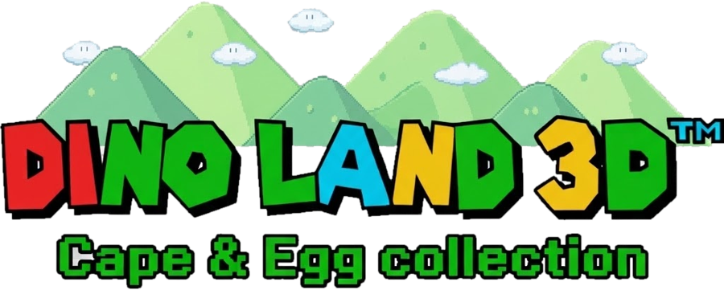
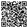

# Dino Land 3D: Cape & Egg Collection

**ES** · Dos clásicos de plataformas de 16 bits en tu Nintendo 3DS: la pantalla táctil se convierte en un panel vivo y el 3D separa el escenario en capas.
**EN** · Two classic 16-bit platformers on your Nintendo 3DS: the touch screen becomes a live panel and 3D splits the scenery into layers.

🌐 **https://chrzazueta.github.io/DinoLand3D-3DS/**

> [!IMPORTANT]
> Necesitas **tus propias copias** de los cartuchos (versión de EE. UU.). Aquí no se distribuye ninguna ROM.
> You need **your own copies** of the cartridges (USA version). No ROMs are distributed here.

## Características / Features

- Pantalla táctil con contadores, progreso por mundo, mapa, inventario y ajustes · live touch screen with counters, per-world progress, map, inventory and settings
- 3D por capas con el deslizador · layered 3D with the slider
- Barra de estado original en la pantalla inferior · original status bar on the bottom screen
- El fondo del nivel detrás del panel táctil · the level background behind the touch panel
- 3 estados de guardado con miniatura por juego · 3 save states with thumbnails per game
- Se actualiza con un toque (con Wi-Fi) · updates itself with one tap (with Wi-Fi)
- Español e inglés · Spanish and English

## Instalación / Installation

1. Consola con Luma3DS ([3ds.hacks.guide](https://3ds.hacks.guide/)) · console with Luma3DS.
2. Instala `DinoLand3D.cia` con FBI (recomendado) o copia `DinoLand3D.3dsx` a `sdmc:/3ds/` · install the CIA with FBI (recommended) or copy the .3dsx to `sdmc:/3ds/`. Ambos en / both in [Releases](https://github.com/ChrZazueta/DinoLand3D-3DS/releases/latest).

   **QR para FBI** (Remote Install → Scan QR Code) · **QR for FBI**:

   

3. Copia tus ROMs a `sdmc:/3ds/DinoLand3D/` como `Super.sfc` (1990) y `Super2.sfc` (1995) · copy your ROMs there with those names.
   SHA-1 sin cabecera / without header: `Super.sfc` `6b47bb75d16514b6a476aa0c73a683a2a4c18765` · `Super2.sfc` `c807f2856f44fb84326fac5b462340dcdd0471f8`
4. Audio: `sdmc:/3ds/dspfirm.cdc` (DSP1).

## Apoya el proyecto / Support

Dino Land 3D es gratis. Si te gusta, puedes invitarme un café · It's free; if you enjoy it, you can buy me a coffee:
**[ko-fi.com/chrisplay](https://ko-fi.com/chrisplay)** ☕

---
Proyecto de aficionado sin ánimo de lucro, no afiliado a ningún fabricante de consolas. Basado en [snes9x_3ds](https://github.com/matbo87/snes9x_3ds).
Non-profit fan project, not affiliated with any console maker. Based on snes9x_3ds.
